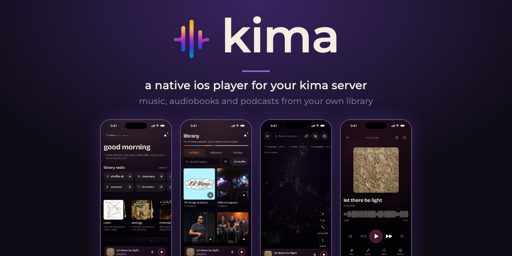
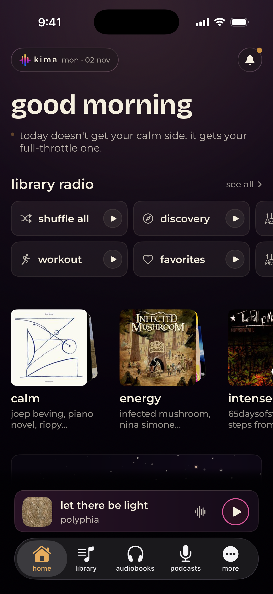
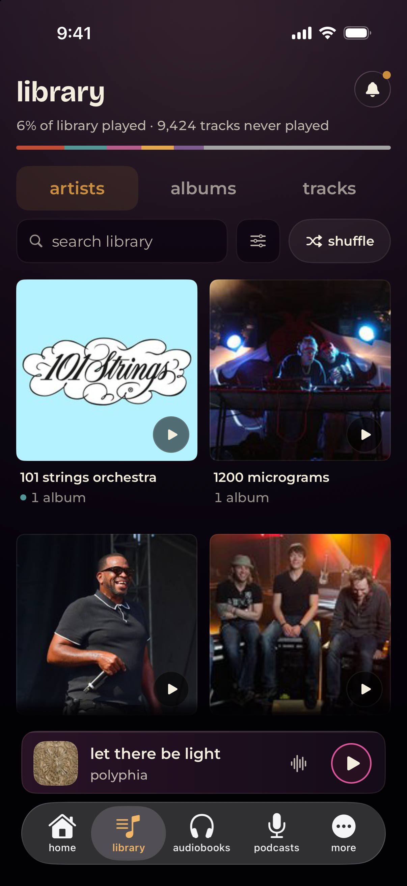
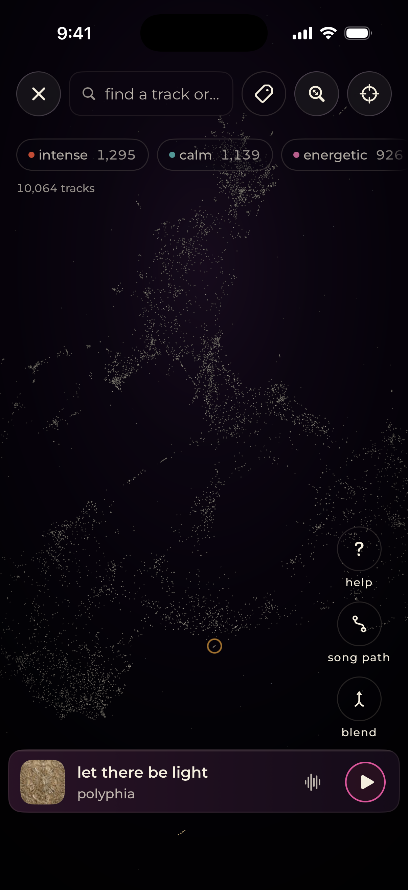
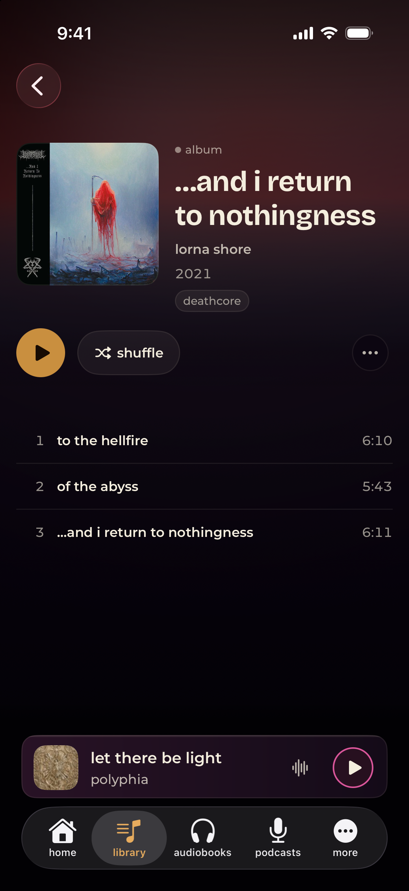
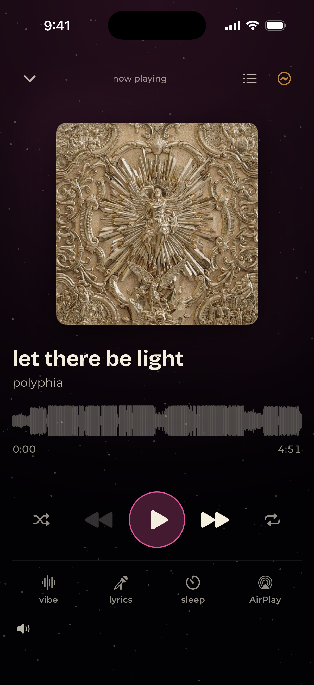
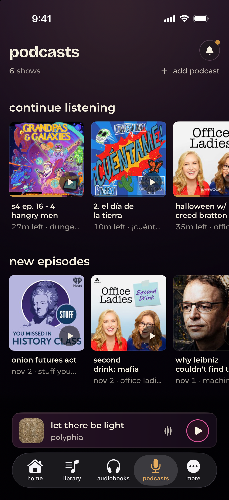

<p align="center"></p>

<p align="center">
  <a href="https://github.com/Chevron7Locked/kima-hub"></a>
  
</p>

Kima for iOS is a native iPhone and iPad app for [Kima](https://github.com/Chevron7Locked/kima-hub), the self-hosted music, audiobook and podcast server. It plays your own library with the system audio stack, so playback keeps going in the background, on the lock screen and in the car. The app has no backend of its own: it needs a running Kima server, and apart from public cover art it talks to nothing else unless you choose to report a problem on GitHub.

<p align="center">
  
  
  
  
  
  
</p>

## Features

- **Music:** browse by artist, album, track and playlist, search the library, play radio stations and mood mixes, and open a weekly discovery list.
- **Playback:** background audio, lock screen and Control Center controls, AirPlay, a queue you can reorder, a sleep timer and synced lyrics.
- **CarPlay:** the CarPlay interface is built and registered as a scene. It appears in a car only once Apple grants the restricted CarPlay Audio entitlement, which this project's `Kima.entitlements` does not currently request — see the note in that file.
- **Audiobooks and podcasts:** chapters, resume where you left off, playback speed, podcast subscriptions, and one list of new and unfinished episodes across your shows.
- **Vibe map:** a map of your library where tracks that sound alike sit close together.
- **Stats:** what you play, when you play it, and how much of the library you have heard.
- **Playlist import:** bring in a playlist from a link to another service.
- **Shared links:** open playlists, albums and tracks shared from a Kima server.

## Requirements

- iOS 18 or later (iPhone and iPad)
- A Kima server you can reach from the device

## Building

1. Install [XcodeGen](https://github.com/yonaskolb/XcodeGen): `brew install xcodegen`
2. Install Apple's Metal toolchain once per machine (the vibe map renders with Metal): `xcodebuild -downloadComponent MetalToolchain`
3. Generate the Xcode project: `xcodegen generate`
4. Open `Kima.xcodeproj` in Xcode 27 and run the **Kima** scheme.

The project file is generated from `project.yml` and is not checked in. Run `xcodegen generate` again after adding or removing source files. Set your own development team under Signing before running on a device.

## Tests

```sh
# Unit tests (no server needed)
xcodebuild test -project Kima.xcodeproj -scheme Kima \
  -destination 'platform=iOS Simulator,name=iPhone 17 Pro' -only-testing:KimaTests
```

`KimaUITests` holds the UI tests. Some need a signed-in simulator and a live server. The rest use debug-only launch arguments such as `-kima-fake-signed-in` and `-kima-vibe-synthetic` and need no server.

## Project layout

```
Kima/
  Core/          networking, models, session and keychain, live events
  Player/        audio engine, queue, now playing, remote commands
  CarPlay/       CarPlay scene
  DesignSystem/  shared views, colours and type
  Features/      one folder per screen area
  Resources/     fonts and bundled data
KimaTests/       unit tests
KimaUITests/     UI tests
docs/            server API reference
scripts/         development scripts (regenerates the API reference, vibe map screenshots)
```

`docs/api-endpoints.md` lists the Kima server endpoints the app uses.

## Privacy

The app sends nothing to the developer. See [PRIVACY.md](PRIVACY.md).

## Licence

All rights reserved, see [LICENSE](LICENSE). The source is public so you can check what the app does.

## Acknowledgements

The app bundles [Bricolage Grotesque](https://github.com/ateliertriay/bricolage) and [Montserrat](https://github.com/JulietaUla/Montserrat), both under the SIL Open Font License. The licence texts are in `Kima/Resources/Fonts`.
